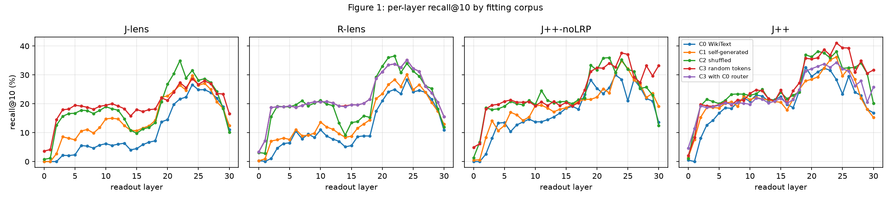
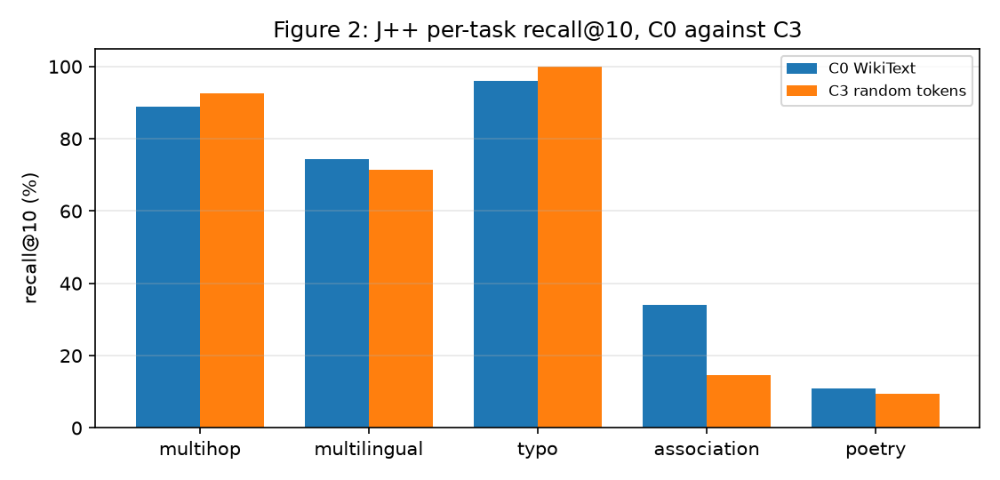
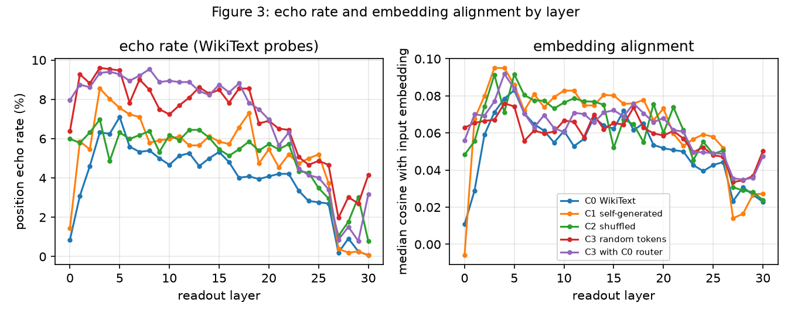
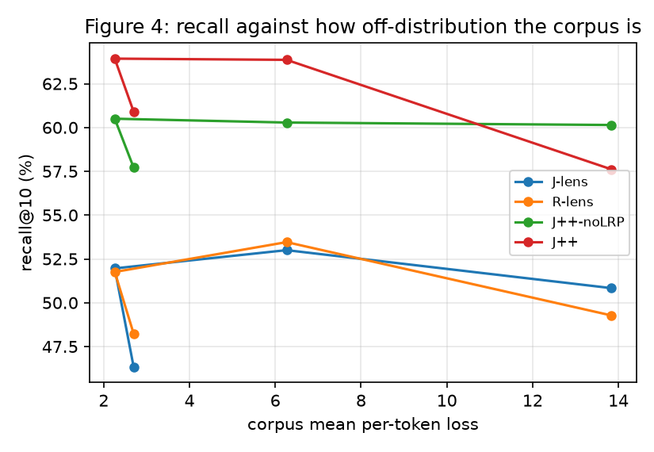

# Gibberish-fit workspace lenses: results

How much do the J-lens, R-lens and J++ lens depend on the text they are fitted on?
All three were refitted on Qwen3.5-9B over four fitting corpora and scored on the same
held-out readout items. Predictions were registered in `PREREGISTRATION.md` before any
condition was fitted.

## Summary

**Held-out recall@10**, macro over the five evals, item-weighted, any of the 31 readout layers, Readout Filtering on. 95% intervals from 10,000 item resamples, seed 0.

| condition | J-lens | R-lens | J++-noLRP | J++ |
|---|---|---|---|---|
| C0 WikiText | 46.33 [42.49, 49.92] | 48.23 [44.85, 51.41] | 57.71 [53.54, 61.90] | 60.90 [57.07, 64.72] |
| C1 self-generated | 51.96 [48.54, 55.17] | 51.76 [48.55, 54.75] | 60.50 [56.67, 64.28] | 63.93 [60.23, 67.59] |
| C2 shuffled | 53.00 [49.52, 56.15] | 53.46 [50.30, 56.44] | 60.28 [57.11, 63.41] | 63.86 [60.55, 67.08] |
| C3 random tokens | 50.83 [47.61, 53.87] | 49.28 [46.28, 51.93] | 60.14 [57.06, 63.12] | 57.61 [54.45, 60.60] |
| C3 with C0 router | -- | 49.28 [46.21, 51.98] | -- | 53.92 [50.85, 56.72] |

logit lens, same harness: **39.56%**

released J++ 9B, same harness: **63.03%**

**Held-out recall@1**, macro over the five evals, item-weighted, any of the 31 readout layers, Readout Filtering on. 95% intervals from 10,000 item resamples, seed 0.

| condition | J-lens | R-lens | J++-noLRP | J++ |
|---|---|---|---|---|
| C0 WikiText | 23.86 [19.44, 28.23] | 25.82 [21.43, 30.33] | 36.94 [32.20, 41.66] | 41.38 [36.77, 45.96] |
| C1 self-generated | 30.60 [26.17, 35.10] | 30.40 [25.89, 34.96] | 39.75 [35.44, 44.13] | 41.09 [36.72, 45.45] |
| C2 shuffled | 33.05 [28.85, 37.23] | 36.57 [32.57, 40.70] | 37.90 [33.70, 42.16] | 41.94 [37.80, 46.07] |
| C3 random tokens | 30.07 [26.55, 33.97] | 34.04 [30.27, 37.90] | 38.87 [34.72, 43.03] | 39.18 [35.25, 43.30] |
| C3 with C0 router | -- | 34.04 [30.27, 37.85] | -- | 36.08 [32.32, 39.91] |

logit lens, same harness: **14.92%**

released J++ 9B, same harness: **41.88%**

## Gap to C0

Gap to C0, `recall(C0) - recall(Cx)`, percentage points, with 95% intervals from a
paired bootstrap over items (10,000 resamples, seed 0). Pairing matters here: every
condition is scored on identical items, so these intervals are much tighter than the
per-condition intervals above, and they are what any difference claim rests on.

| lens | condition | gap (pp) | 95% CI |
|---|---|---|---|
| J-lens | C1 self-generated | -5.63 | [-8.11, -3.20] |
| J-lens | C2 shuffled | -6.67 | [-9.23, -4.19] |
| J-lens | C3 random tokens | -4.50 | [-7.74, -1.39] |
| R-lens | C1 self-generated | -3.52 | [-5.75, -1.43] |
| R-lens | C2 shuffled | -5.23 | [-7.92, -2.40] |
| R-lens | C3 random tokens | -1.04 | [-3.87, 1.95] |
| R-lens | C3 with C0 router | -1.04 | [-3.87, 1.95] |
| J++-noLRP | C1 self-generated | -2.79 | [-6.16, 0.42] |
| J++-noLRP | C2 shuffled | -2.57 | [-6.69, 1.28] |
| J++-noLRP | C3 random tokens | -2.43 | [-6.54, 1.36] |
| J++ | C1 self-generated | -3.03 | [-6.05, -0.26] |
| J++ | C2 shuffled | -2.96 | [-6.50, 0.31] |
| J++ | C3 random tokens | 3.29 | [0.20, 6.23] |
| J++ | C3 with C0 router | 6.98 | [3.98, 9.87] |

## Fitting corpora

| condition | median tokens | loss | entropy (bits) | type/token | non-alnum |
|---|---|---|---|---|---|
| C0 WikiText | 208 | 2.697 | 9.11 | 0.290 | 0.150 |
| C1 self-generated | 224 | 2.256 | 9.89 | 0.389 | 0.282 |
| C2 shuffled | 207 | 6.264 | 9.20 | 0.300 | 0.151 |
| C3 random tokens | 342 | 13.836 | 12.87 | 0.952 | 0.039 |

## Expert weights and cluster balance

Expert weights and cluster balance. `fallbacks` counts expert slots that kept fewer
than 50 positions and were replaced by the pooled Jacobian, out of 31 layers x 8
clusters = 248. Where an expert falls back, J++ degenerates toward the pooled lens at
that layer, which is a way for H4's rescue to be absent for reasons unrelated to the
fitting text.

| condition | lens | min kept | median kept | max kept | fallbacks / 248 |
|---|---|---|---|---|---|
| C0 WikiText | J++-noLRP | 0 | 880 | 2868 | 27 |
| C0 WikiText | J++ | 0 | 881 | 2871 | 27 |
| C1 self-generated | J++-noLRP | 80 | 812 | 2195 | 0 |
| C1 self-generated | J++ | 80 | 810 | 2195 | 0 |
| C2 shuffled | J++-noLRP | 0 | 775 | 3794 | 21 |
| C2 shuffled | J++ | 0 | 775 | 3794 | 21 |
| C3 random tokens | J++-noLRP | 192 | 859 | 2056 | 0 |
| C3 random tokens | J++ | 192 | 858 | 2058 | 0 |
| C3 with C0 router | J++ | 0 | 29 | 7075 | 140 |

## Verdicts on the pre-registered hypotheses

**H1 (ordering)** C0 >= C1 > C2 > C3 for all three lens types.

- J-lens: NOT supported - C2 shuffled 53.00 > C1 self-generated 51.96 > C3 random tokens 50.83 > C0 WikiText 46.33
- R-lens: NOT supported - C2 shuffled 53.46 > C1 self-generated 51.76 > C3 random tokens 49.28 > C0 WikiText 48.23
- J++: NOT supported - C1 self-generated 63.93 > C2 shuffled 63.86 > C0 WikiText 60.90 > C3 random tokens 57.61

**H2 (depth)** the C0-C3 gap is largest at the earliest readout layers and under 5pp at the deepest.

- J-lens: widest gap by magnitude at layer 5 (-17.14pp), deepest layer 30 (-5.55pp) - NOT supported (C3 outscores C0 at most layers, so the gap this hypothesis describes runs the other way)
- R-lens: widest gap by magnitude at layer 2 (-17.66pp), deepest layer 30 (-4.70pp) - supported (C3 outscores C0 at most layers, so the gap this hypothesis describes runs the other way)
- J++: widest gap by magnitude at layer 25 (-16.04pp), deepest layer 30 (-14.82pp) - NOT supported (C3 outscores C0 at most layers, so the gap this hypothesis describes runs the other way)

**H3 (current-token collapse)** C3 position echo rate exceeds C0's.

- eval_items: C0 0.06%, C3 0.14% - supported
- wikitext: C0 3.93%, C3 7.00% - supported

**H4 (J++ rescue)** the C0-C3 gap is smaller for J++ than for the J-lens and the R-lens.

- J++ 3.29pp, J-lens -4.50pp, R-lens -1.04pp - NOT supported

**H0 (null)** if C3 recall@10 is within 3pp of C0 for a lens type, that lens is set mostly by the model's weights rather than the fitting text.

- J++-noLRP: gap -2.43pp [-6.54, 1.36] - within 3pp, null holds
- J++: gap 3.29pp [0.20, 6.23] - beyond 3pp, null rejected
- J-lens: gap -4.50pp [-7.74, -1.39] - beyond 3pp, null rejected
- R-lens: gap -1.04pp [-3.87, 1.95] - within 3pp, null holds

## Figures

*Per-layer recall@10, one panel per lens type, one line per condition, the logit lens dashed.*

*J++ per-task recall@10 for C0 against C3.*

*Position echo rate and embedding alignment by layer.*

*Recall@10 against corpus mean per-token loss.*

## Deviations from the spec

Each with its reason; the settings were fixed in `PREREGISTRATION.md` before Phase 3.

- **Source layers 0-30, all 31**, not 7 equally spaced: the released lens's own config
  stores 31, and measurement showed 31 layers cost 1.3 GB more GPU than 7, so there was
  no reason to take the cheaper option.
- **`jacobian_rows_per_pass` 4**, not the released config's 48: 48 and 16 both ran out of
  memory at ~30.5 GB on a 32 GB card. It sets only how many rows of J a backward pass
  computes, so the estimator is unchanged.
- **Router pool 256 prompts**, not 1,000: the router pools fp32 CPU activations of
  [positions, 4096] per layer, which at 1,000 prompts over 31 layers is 56 GB and twice
  that at the concatenate. Identical across conditions.
- **C1 sampled from a newline**, not from BOS: this checkpoint has no BOS token. Sampling
  from the endoftext token collapsed into repetition and leaked control tokens into the
  text, and one sample re-encoded to 14 tokens. Special tokens were suppressed.
- **C2's shuffle seed is the record's index in the stream**, not in the kept list: keeping
  a record depends on its shuffled form, so a seed from the kept index would be circular.
- **PyTorch fallback kernels for Gated DeltaNet**: flash-linear-attention was not
  installed. The same path was used for every condition.
- **`order-ops` is absent** because it is not in the pipeline's default item set, not by
  hand: digit-by-digit tokenization breaks it on Qwen.

## Provenance

Every number above comes from a CSV in `results/`: `recall_ci_k*.csv`,
`gap_to_reference.csv`, `per_layer_recall.csv`, `recall_summary.csv`, `echo_rate.csv`,
`embedding_alignment.csv`, `matrix_distance.csv`, `expert_weights.csv`, and the corpus
statistics in `corpora/<cond>_stats.json`. `run_all.sh` reproduces all of it from the
corpora.

The released 9B lens scores differently here than on its model card (55.0%) because this
run uses its own model-correctness column and item split. Both numbers must name their
harness.
